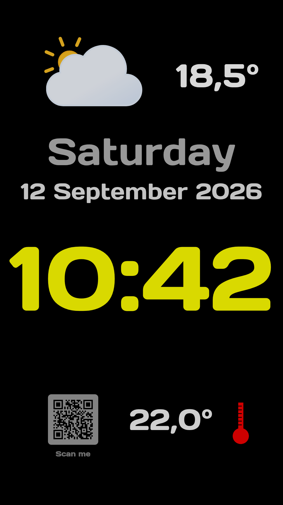
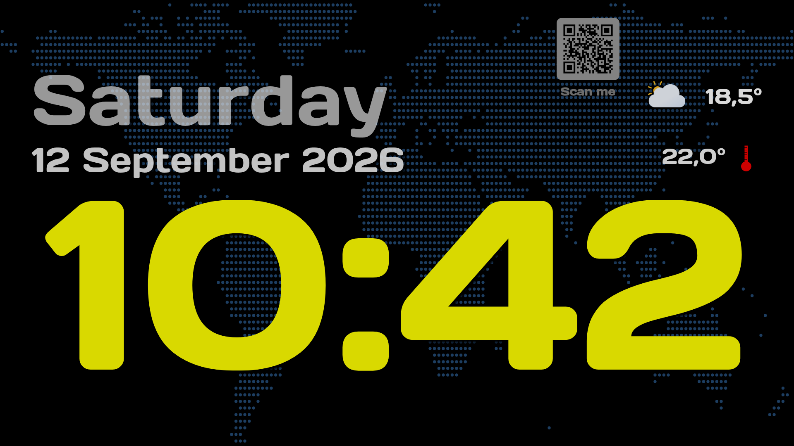
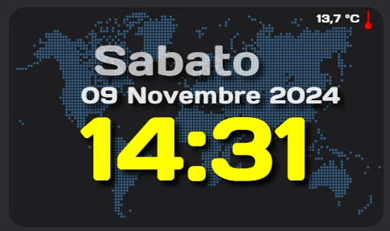

# Tablet Orologio - Big Clock per Home Assistant

[](https://hacs.xyz) [](https://github.com/Simonz82/big_clock/actions/workflows/validate.yml) [](LICENSE)

Orologio a schermo intero per tablet a muro (Fully Kiosk Browser o qualsiasi browser): ora gialla gigante che riempie la larghezza, giorno e data, icona meteo, temperatura esterna e interna, QR Wi-Fi ospite opzionale. Un'unica card, **verticale o orizzontale**, con spostamento anti burn-in.

*Full-screen clock / screensaver card for wall tablets, portrait or landscape. English summary at the bottom.*

| Verticale (`orientation: vertical`) | Orizzontale (`orientation: horizontal`) |
|---|---|
|  |  |

## Caratteristiche

- **A schermo intero**: copre intestazione e barra laterale di Home Assistant (`fullscreen: true`).
- **Verticale o orizzontale**: `orientation: vertical | horizontal`, oppure `auto` (segue la forma dello schermo).
- **Ora che riempie la larghezza**: la grandezza e' calcolata misurando il font, quindi sfrutta tutto lo spazio.
- **Anti burn-in**: il contenuto si sposta di pochi pixel ogni qualche minuto.
- **Luminosita' ridotta** con un velo scuro configurabile (`dim`).
- **Meteo e temperature**: icona dallo stato di un'entita' `weather.*`, temperatura esterna e interna.
- **Giorno e data** da due sensori, oppure generati dalla lingua di Home Assistant se non li configuri.
- Nessuna dipendenza da altre card.

## Installazione

**HACS (repository personalizzato)**: HACS > menu a tre puntini > Repository personalizzati > `https://github.com/Simonz82/big_clock`, tipo *Dashboard*, poi scarica "Tablet Orologio".

**Manuale**: copia `tablet-orologio-card.js` in `/config/www/` e aggiungi la risorsa `/local/tablet-orologio-card.js` (tipo *Modulo JavaScript*) in Impostazioni > Dashboard > menu > Risorse.

### Font Days One

La card usa il font **Days One** (licenza SIL Open Font License 1.1, uso e ridistribuzione liberi). Per default viene caricato da Google Fonts alla prima apertura (`google_font: true`). Se non vuoi richieste esterne metti `google_font: false` e installa il font nel tuo tema o come risorsa; senza il font la card usa un carattere di ripiego.

### Icone meteo

Le icone si cercano in `weather_icons` come `<stato>.svg` (es. `/local/weather_icons/sunny.svg`). Un set completo e' in [`classic/www/weather_icons/`](classic/www/weather_icons): copialo in `/config/www/weather_icons/`.

## Configurazione

Aggiungi una card manuale a una vista in modalita' *Pannello* (a pagina intera):

```yaml
type: custom:tablet-orologio-card
orientation: horizontal
time: sensor.time
weekday: sensor.giorno_settimana
date: sensor.data_estesa
temp_out: sensor.temperatura_esterna
temp_in: sensor.temperatura_salotto
weather: weather.casa
background: /local/sfondi/nero.jpg
thermometer: /local/orologio/thermo.png
```

`sensor.time` e' il sensore dell'integrazione *Ora e data* (tipo "Ora"). Se `time` manca o non e' disponibile si usa l'ora del dispositivo.

### Verticale e orizzontale

```yaml
type: custom:tablet-orologio-card
orientation: vertical     # meteo, giorno, data, ora, poi temperatura interna (e QR) in basso
```

```yaml
type: custom:tablet-orologio-card
orientation: horizontal   # giorno e data in alto a sinistra, temperature a destra, ora sotto a tutta larghezza
```

`auto` (predefinito) mantiene il comportamento della prima versione: layout verticale su schermi alti e orizzontale su schermi larghi.

### Opzioni

| Opzione | Tipo | Predefinito | Descrizione |
|---|---|---|---|
| `orientation` | string | `auto` | `auto`, `vertical` o `horizontal` |
| `time` | string | `sensor.time` | Entita' con l'ora `HH:MM` (altrimenti ora del dispositivo) |
| `weekday` | string | vuoto | Entita' con il giorno della settimana (altrimenti dalla lingua di HA) |
| `date` | string | vuoto | Entita' con la data (altrimenti dalla lingua di HA) |
| `temp_out` | string | vuoto | Temperatura esterna (mostra `--` se non disponibile) |
| `temp_in` | string | vuoto | Temperatura interna |
| `weather` | string | vuoto | Entita' `weather.*` per l'icona |
| `weather_icons` | string | `/local/weather_icons/` | Cartella delle icone `<stato>.svg` |
| `background` | string | vuoto | Immagine di sfondo (altrimenti nero) |
| `thermometer` | string | vuoto | Icona accanto alla temperatura interna |
| `wifi_image` | string | vuoto | Immagine del QR Wi-Fi ospite |
| `wifi_label` | string | vuoto | Testo sotto il QR |
| `dim` | number | `0.85` | Luminosita' complessiva (1 = piena) |
| `shift_px` | number | `14` | Ampiezza dello spostamento anti burn-in |
| `shift_minutes` | number | `4` | Ogni quanti minuti sposta |
| `fullscreen` | boolean | `true` | Copre intestazione e barra laterale |
| `google_font` | boolean | `true` | Carica Days One da Google Fonts se manca |

Per provare la larghezza con un'ora qualsiasi aggiungi `?orologio_test=23:58` all'indirizzo della vista.

### Fully Kiosk come salvaschermo

In Fully Kiosk imposta come *Screensaver Wallpaper URL* l'indirizzo della vista con la card (es. `http://homeassistant.local:8123/dashboard-orologio/clock`).

## Versione classica

La prima versione (card YAML `picture-elements`, sensori e immagini) e' ancora nel repository, nella cartella [`classic/`](classic): vedi [classic/README.md](classic/README.md).



## Changelog

Vedi [CHANGELOG.md](CHANGELOG.md).

## English summary

**Tablet Orologio** is a full-screen clock card for wall tablets: big yellow time scaled to the full width, weekday and date, weather icon, outdoor and indoor temperature, optional guest Wi-Fi QR, anti burn-in shifting and dimming. Use `orientation: vertical`, `horizontal` or `auto` (default).

- **Install**: HACS > Custom repositories > `https://github.com/Simonz82/big_clock` (type *Dashboard*), or copy `tablet-orologio-card.js` to `/config/www/` and add `/local/tablet-orologio-card.js` as a JavaScript module.
- **Font**: Days One (SIL OFL 1.1), loaded from Google Fonts unless `google_font: false`.
- **Weather icons**: SVGs named after the weather state, see `classic/www/weather_icons/`.
- Options are listed in the table above. Weekday and date fall back to the Home Assistant language.
- The original YAML version is kept in [`classic/`](classic).

---

## ☕ Vuoi darmi una mano?

Il contenuto di questa pagina è completamente gratuito e lo scopo non è certamente fare soldi. Se vuoi darmi una mano per le spese e il tempo perso, ecco alcuni modi:

| | |
|---|---|
| [](https://ko-fi.com/C0C713VTGJ) | Offrimi un caffè su Ko-fi |
| [](https://www.paypal.com/paypalme/simongmail) | Una donazione libera su PayPal |
| [](https://amzn.to/3XWWTgz) | Fai i tuoi acquisti Amazon partendo da questo link |

**Canali Telegram:**

| | |
|---|---|
| [](https://t.me/Home_Assistant_News) | Notizie dedicate a Home Assistant |
| [](https://t.me/offerte_domotica_ita) | Offerte sui prodotti di domotica |

---

Sviluppato e curato da [Simonz82](https://t.me/Simonz82) · © 2026
